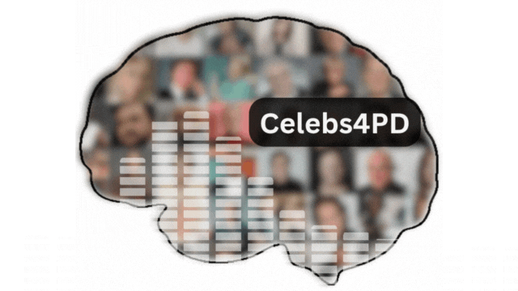



  

<b>Authors:</b> <strong>El-Mufti, N.</strong>, Kersten-Oertel, M., &amp; Ravanelli, M.

Coming soon

Project description

Celebs4PD is a corpus of longitudinal, in-the-wild speech from 60 public figures, 30 with Parkinson’s disease and 30 without, drawn from publicly available media recorded between 1959 and 2025. Each person with Parkinson’s disease is matched to a control on sex, birth year, race and profession, and only the target speaker’s speech is kept, so that what a model learns comes from the disease rather than from demographic confounders. The corpus holds 700 recordings and 138.64 hours of speech, mostly in English with some in French, and most participants with Parkinson’s disease have recordings from both before and after their reported diagnosis.

This study will test whether pretraining on Celebs4PD improves the detection of Parkinson’s disease from clinical speech. A classification head on a frozen speech foundation model will be pretrained on Celebs4PD, then fine-tuned on five clinical datasets in Arabic, English, French, Italian and Spanish, and compared with the same model trained without pretraining and with one pretrained on ParkCeleb, an existing corpus of celebrity speech.

Clinical participants will be matched on age, sex and recording conditions, and a few-shot experiment will measure how much clinical data pretraining can save. The final models will be evaluated on external datasets never used during development, and the corpus will be released with full documentation to support its responsible use.

