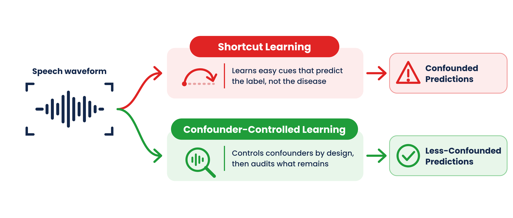



  

<b>Authors:</b> <strong>El-Mufti, N.</strong>, Ravanelli, M., &amp; Kersten-Oertel, M.

Coming soon

Project description

Speech-based models for Parkinson’s disease can reach high accuracy by learning shortcuts rather than the disease itself. In clinical datasets, age, sex, recording equipment, background noise, the speech tasks recorded and even silence can separate patients from controls.

This study will audit what speech foundation models rely on across five clinical datasets. Models trained on pairs matched on age, sex and recording conditions will be compared with models trained on pairs matched on age and sex alone and on all participants, to measure what each level of matching is worth and what it costs in data. Simple baselines using age and sex, recording length, the recorded tasks or the file format, a silence-only test, leave-one-dataset-out validation and probes of each encoder layer will show what the models still rely on.

To confirm that the audit detects a shortcut when one exists, known acoustic cues will be added to the training recordings of the Parkinson’s group at increasing strength. A within-group test will ask whether scores still track age, sex, dataset or recording setup among patients and among controls, and the worst-performing group will be reported next to the average, so that gaps between sexes, datasets, recording setups and languages remain visible.

